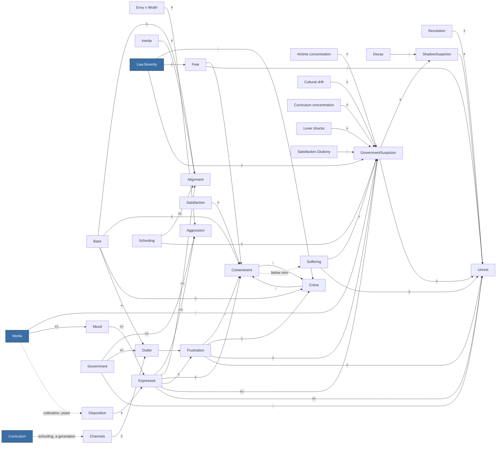

<!-- GENERATED by Tools/Headless/Runner (docs command). Do not edit by hand: change the code, then regenerate. -->
# Society causal graph

What feeds what in the society model, observed from the ledger rather than declared: every term the
simulation recorded while the three-nation scenario ran each built-in lever script for 60 years
(baseline, wrath-media, military-school, iron-fist, velvet-glove, bread-and-circuses, stoke-then-channel, scholars, false-revolution, people-vote, propaganda, monoculture, extremist, whiplash, slow-burn, tyranny). Solid arrows are observed terms; dotted arrows are slow stock dynamics
that the ledger does not record (declared in Tools/Headless/Runner/DocsCommand.cs). The model itself is
explained in Docs/simulation/MODEL.md.

## Overview (per-vice quantities merged)

## Every observed term

Rows marked `*` stand for seven rows, one per vice (Media.Wrath -> Mood.Wrath, and so on).
Typical size is the mean absolute contribution per tick across all runs and nations.

| Source | Target | Sign | Typical size |
|---|---|---|---|
| Envy x Wrath | Aggression | + | 0.0635 |
| Expressed.Envy | Aggression | + | 0.0352 |
| Expressed.Gluttony | Aggression | + | 0.0205 |
| Expressed.Greed | Aggression | + | 0.0668 |
| Expressed.Pride | Aggression | + | 0.0556 |
| Expressed.Sloth | Aggression | - | 0.0554 |
| Expressed.Wrath | Aggression | + | 0.2010 |
| Government | Aggression | +/- | 0.0826 |
| Base | Alignment.Communism | + | 0.0500 |
| Expressed.Envy | Alignment.Communism | +/- | 0.0576 |
| Expressed.Greed | Alignment.Communism | +/- | 0.0096 |
| Inertia | Alignment.Communism | + | 0.0500 |
| Schooling.Agriculture | Alignment.Communism | +/- | 0.0243 |
| Schooling.Infrastructure | Alignment.Communism | +/- | 0.0162 |
| Base | Alignment.Democracy | + | 0.1000 |
| Expressed.Envy | Alignment.Democracy | +/- | 0.0247 |
| Expressed.Pride | Alignment.Democracy | +/- | 0.0331 |
| Expressed.Wrath | Alignment.Democracy | +/- | 0.0205 |
| Inertia | Alignment.Democracy | + | 0.0500 |
| Schooling.Commerce | Alignment.Democracy | +/- | 0.0354 |
| Schooling.Infrastructure | Alignment.Democracy | +/- | 0.0162 |
| Schooling.Science | Alignment.Democracy | +/- | 0.0301 |
| Base | Alignment.MilitaryJunta | + | 0.0500 |
| Expressed.Pride | Alignment.MilitaryJunta | +/- | 0.0441 |
| Expressed.Wrath | Alignment.MilitaryJunta | +/- | 0.1229 |
| Inertia | Alignment.MilitaryJunta | + | 0.0500 |
| Schooling.Military | Alignment.MilitaryJunta | +/- | 0.0954 |
| Base | Alignment.Monarchy | + | 0.1000 |
| Expressed.Pride | Alignment.Monarchy | +/- | 0.0441 |
| Expressed.Sloth | Alignment.Monarchy | +/- | 0.0547 |
| Inertia | Alignment.Monarchy | + | 0.0500 |
| Schooling.Agriculture | Alignment.Monarchy | +/- | 0.0243 |
| Schooling.Military | Alignment.Monarchy | +/- | 0.0191 |
| Base | Alignment.Theocracy | + | 0.0500 |
| Expressed.Gluttony | Alignment.Theocracy | +/- | 0.0285 |
| Expressed.Lust | Alignment.Theocracy | +/- | 0.0171 |
| Expressed.Sloth | Alignment.Theocracy | +/- | 0.0684 |
| Inertia | Alignment.Theocracy | + | 0.0500 |
| Schooling.Arts | Alignment.Theocracy | +/- | 0.0129 |
| Schooling.Science | Alignment.Theocracy | +/- | 0.0402 |
| Base | Contentment | + | 0.1500 |
| Crime | Contentment | - | 0.0354 |
| Expressed.Sloth | Contentment | + | 0.0226 |
| Fear | Contentment | - | 0.0698 |
| Frustration.Envy | Contentment | - | 0.0445 |
| Frustration.Gluttony | Contentment | - | 0.0623 |
| Frustration.Greed | Contentment | - | 0.0165 |
| Frustration.Lust | Contentment | - | 0.0216 |
| Frustration.Pride | Contentment | - | 0.0141 |
| Frustration.Sloth | Contentment | - | 0.0390 |
| Frustration.Wrath | Contentment | - | 0.0603 |
| Satisfaction | Contentment | + | 0.1731 |
| Base | Crime | + | 0.1200 |
| Contentment | Crime | - | 0.0241 |
| Frustration.Envy | Crime | + | 0.0271 |
| Frustration.Gluttony | Crime | + | 0.0126 |
| Frustration.Greed | Crime | + | 0.0115 |
| Frustration.Lust | Crime | + | 0.0043 |
| Frustration.Pride | Crime | + | 0.0028 |
| Frustration.Sloth | Crime | + | 0.0039 |
| Frustration.Wrath | Crime | + | 0.0425 |
| Law.Severity | Crime | - | 0.0625 |
| Disposition.* | Expressed.* | + | 0.3773 |
| Mood.* | Expressed.* | +/- | 0.0503 |
| Law.Severity | Fear | + | 0.3123 |
| Expressed.* | Frustration.* | + | 0.4602 |
| Outlet.* | Frustration.* | - | 0.3858 |
| Airtime concentration | GovernmentSuspicion | + | 0.4547 |
| Cultural drift | GovernmentSuspicion | + | 0.0642 |
| Curriculum concentration | GovernmentSuspicion | + | 0.1954 |
| Expressed.Pride | GovernmentSuspicion | + | 0.0556 |
| Expressed.Sloth | GovernmentSuspicion | - | 0.0554 |
| Frustration.Envy | GovernmentSuspicion | + | 0.0452 |
| Frustration.Greed | GovernmentSuspicion | + | 0.0164 |
| Law.Severity | GovernmentSuspicion | + | 0.0327 |
| Lever shocks | GovernmentSuspicion | + | 0.0451 |
| Media.Neutral | GovernmentSuspicion | - | 0.0180 |
| Satisfaction.Gluttony | GovernmentSuspicion | - | 0.0711 |
| Schooling.Science | GovernmentSuspicion | + | 0.0520 |
| Suffering | GovernmentSuspicion | + | 0.0633 |
| Media.* | Mood.* | +/- | 0.0483 |
| Channels.* | Outlet.* | + | 0.1302 |
| Base | Outlet.Envy | + | 0.2500 |
| Government | Outlet.Envy | + | 0.0613 |
| Base | Outlet.Gluttony | + | 0.2500 |
| Government | Outlet.Gluttony | - | 0.0800 |
| Base | Outlet.Greed | + | 0.2500 |
| Government | Outlet.Greed | - | 0.1000 |
| Base | Outlet.Lust | + | 0.2500 |
| Government | Outlet.Lust | - | 0.0800 |
| Base | Outlet.Pride | + | 0.2500 |
| Government | Outlet.Pride | + | 0.0613 |
| Base | Outlet.Sloth | + | 0.2500 |
| Government | Outlet.Sloth | + | 0.0800 |
| Base | Outlet.Wrath | + | 0.2500 |
| Government | Outlet.Wrath | + | 0.1000 |
| Decay | ShadowSuspicion | - | 0.0009 |
| GovernmentSuspicion | ShadowSuspicion | + | 0.0058 |
| Expressed.Envy | Unrest | + | 0.0498 |
| Expressed.Pride | Unrest | + | 0.0256 |
| Expressed.Sloth | Unrest | - | 0.0369 |
| Fear | Unrest | - | 0.0781 |
| Frustration.Wrath | Unrest | + | 0.0362 |
| Government | Unrest | - | 0.0400 |
| GovernmentSuspicion | Unrest | + | 0.1586 |
| Revolution | Unrest | + | 0.5000 |
| ShadowSuspicion | Unrest | + | 0.2209 |
| Suffering | Unrest | + | 0.2003 |
