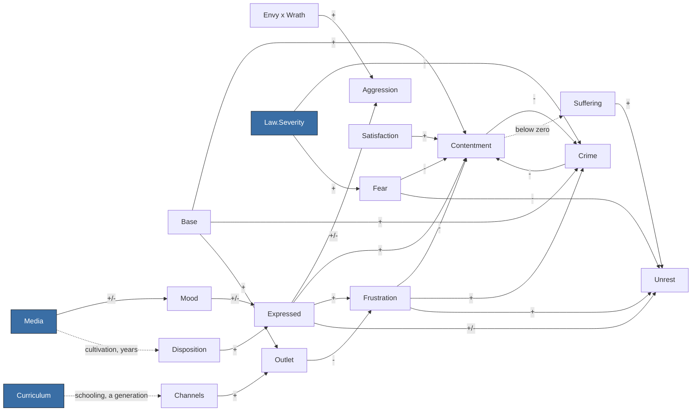

<!-- GENERATED by Tools/Headless/Runner (docs command). Do not edit by hand: change the code, then regenerate. -->
# Society causal graph

What feeds what in the society model, observed from the ledger rather than declared: every term the
simulation recorded while the three-nation scenario ran each built-in lever script for 60 years
(baseline, wrath-media, military-school, iron-fist, velvet-glove, bread-and-circuses, stoke-then-channel). Solid arrows are observed terms; dotted arrows are slow stock dynamics
that the ledger does not record (declared in Tools/Headless/Runner/DocsCommand.cs). The model itself is
explained in Docs/simulation/MODEL.md.

## Overview (per-vice quantities merged)

## Every observed term

Rows marked `*` stand for seven rows, one per vice (Media.Wrath -> Mood.Wrath, and so on).
Typical size is the mean absolute contribution per tick across all runs and nations.

| Source | Target | Sign | Typical size |
|---|---|---|---|
| Envy x Wrath | Aggression | + | 0.0608 |
| Expressed.Envy | Aggression | + | 0.0336 |
| Expressed.Gluttony | Aggression | + | 0.0205 |
| Expressed.Greed | Aggression | + | 0.0686 |
| Expressed.Pride | Aggression | + | 0.0563 |
| Expressed.Sloth | Aggression | - | 0.0554 |
| Expressed.Wrath | Aggression | + | 0.1966 |
| Base | Contentment | + | 0.1500 |
| Crime | Contentment | - | 0.0449 |
| Expressed.Sloth | Contentment | + | 0.0106 |
| Fear | Contentment | - | 0.0900 |
| Frustration.Envy | Contentment | - | 0.0085 |
| Frustration.Gluttony | Contentment | - | 0.0197 |
| Frustration.Greed | Contentment | - | 0.0085 |
| Frustration.Lust | Contentment | - | 0.0078 |
| Frustration.Pride | Contentment | - | 0.0142 |
| Frustration.Sloth | Contentment | - | 0.0150 |
| Frustration.Wrath | Contentment | - | 0.0239 |
| Satisfaction | Contentment | + | 0.1650 |
| Base | Crime | + | 0.1200 |
| Contentment | Crime | - | 0.0200 |
| Frustration.Envy | Crime | + | 0.0149 |
| Frustration.Gluttony | Crime | + | 0.0115 |
| Frustration.Greed | Crime | + | 0.0174 |
| Frustration.Lust | Crime | + | 0.0045 |
| Frustration.Pride | Crime | + | 0.0083 |
| Frustration.Sloth | Crime | + | 0.0044 |
| Frustration.Wrath | Crime | + | 0.0488 |
| Law.Severity | Crime | - | 0.0600 |
| Disposition.* | Expressed.* | + | 0.3773 |
| Mood.* | Expressed.* | +/- | 0.0269 |
| Law.Severity | Fear | + | 0.3000 |
| Expressed.* | Frustration.* | + | 0.4335 |
| Outlet.* | Frustration.* | - | 0.3541 |
| Media.* | Mood.* | +/- | 0.0231 |
| Channels.* | Outlet.* | + | 0.0980 |
| Base | Outlet.Envy | + | 0.2500 |
| Base | Outlet.Gluttony | + | 0.2500 |
| Base | Outlet.Greed | + | 0.2500 |
| Base | Outlet.Lust | + | 0.2500 |
| Base | Outlet.Pride | + | 0.2500 |
| Base | Outlet.Sloth | + | 0.2500 |
| Base | Outlet.Wrath | + | 0.2500 |
| Expressed.Envy | Unrest | + | 0.0004 |
| Expressed.Pride | Unrest | + | 0.0005 |
| Expressed.Sloth | Unrest | - | 0.0554 |
| Fear | Unrest | - | 0.0600 |
| Frustration.Wrath | Unrest | + | 0.0418 |
| Suffering | Unrest | + | 0.0024 |
