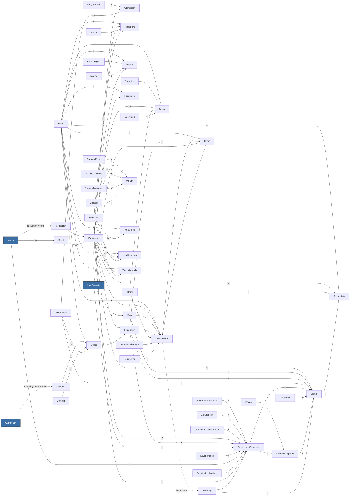

<!-- GENERATED by Tools/Headless/Runner (docs command). Do not edit by hand: change the code, then regenerate. -->
# Society causal graph

What feeds what in the society model, observed from the ledger rather than declared: every term the
simulation recorded while the three-nation scenario ran each built-in lever script for 60 years
(baseline, wrath-media, military-school, iron-fist, velvet-glove, bread-and-circuses, stoke-then-channel, scholars, false-revolution, people-vote, propaganda, monoculture, extremist, whiplash, slow-burn, tyranny, baby-boom, farmers, merchants, famine). Solid arrows are observed terms; dotted arrows are slow stock dynamics
that the ledger does not record (declared in Tools/Headless/Runner/DocsCommand.cs). The model itself is
explained in Docs/simulation/MODEL.md.

## Overview (per-vice quantities merged)

## Every observed term

Rows marked `*` stand for seven rows, one per vice (Media.Wrath -> Mood.Wrath, and so on).
Typical size is the mean absolute contribution per tick across all runs and nations.

| Source | Target | Sign | Typical size |
|---|---|---|---|
| Envy x Wrath | Aggression | + | 0.0618 |
| Expressed.Envy | Aggression | + | 0.0346 |
| Expressed.Gluttony | Aggression | + | 0.0207 |
| Expressed.Greed | Aggression | + | 0.0674 |
| Expressed.Pride | Aggression | + | 0.0558 |
| Expressed.Sloth | Aggression | - | 0.0556 |
| Expressed.Wrath | Aggression | + | 0.1959 |
| Government | Aggression | +/- | 0.0806 |
| Base | Alignment.Communism | + | 0.0500 |
| Expressed.Envy | Alignment.Communism | +/- | 0.0537 |
| Expressed.Greed | Alignment.Communism | +/- | 0.0101 |
| Inertia | Alignment.Communism | + | 0.0500 |
| Schooling.Agriculture | Alignment.Communism | +/- | 0.0244 |
| Schooling.Infrastructure | Alignment.Communism | +/- | 0.0161 |
| Base | Alignment.Democracy | + | 0.1000 |
| Expressed.Envy | Alignment.Democracy | +/- | 0.0230 |
| Expressed.Pride | Alignment.Democracy | +/- | 0.0327 |
| Expressed.Wrath | Alignment.Democracy | +/- | 0.0197 |
| Inertia | Alignment.Democracy | + | 0.0500 |
| Schooling.Commerce | Alignment.Democracy | +/- | 0.0351 |
| Schooling.Infrastructure | Alignment.Democracy | +/- | 0.0161 |
| Schooling.Science | Alignment.Democracy | +/- | 0.0286 |
| Base | Alignment.MilitaryJunta | + | 0.0500 |
| Expressed.Pride | Alignment.MilitaryJunta | +/- | 0.0436 |
| Expressed.Wrath | Alignment.MilitaryJunta | +/- | 0.1185 |
| Inertia | Alignment.MilitaryJunta | + | 0.0500 |
| Schooling.Military | Alignment.MilitaryJunta | +/- | 0.0942 |
| Base | Alignment.Monarchy | + | 0.1000 |
| Expressed.Pride | Alignment.Monarchy | +/- | 0.0436 |
| Expressed.Sloth | Alignment.Monarchy | +/- | 0.0536 |
| Inertia | Alignment.Monarchy | + | 0.0500 |
| Schooling.Agriculture | Alignment.Monarchy | +/- | 0.0244 |
| Schooling.Military | Alignment.Monarchy | +/- | 0.0188 |
| Base | Alignment.Theocracy | + | 0.0500 |
| Expressed.Gluttony | Alignment.Theocracy | +/- | 0.0288 |
| Expressed.Lust | Alignment.Theocracy | +/- | 0.0177 |
| Expressed.Sloth | Alignment.Theocracy | +/- | 0.0671 |
| Inertia | Alignment.Theocracy | + | 0.0500 |
| Schooling.Arts | Alignment.Theocracy | +/- | 0.0133 |
| Schooling.Science | Alignment.Theocracy | +/- | 0.0382 |
| Base | Births | + | 0.0330 |
| Crowding | Births | - | 0.0018 |
| Expressed.Lust | Births | +/- | 0.0029 |
| Expressed.Pride | Births | +/- | 0.0018 |
| Hunger | Births | - | 0.0096 |
| Open land | Births | + | 0.0026 |
| Base | Contentment | + | 0.1500 |
| Crime | Contentment | - | 0.0356 |
| Expressed.Sloth | Contentment | + | 0.0246 |
| Fear | Contentment | - | 0.0706 |
| Frustration.Envy | Contentment | - | 0.0407 |
| Frustration.Gluttony | Contentment | - | 0.0741 |
| Frustration.Greed | Contentment | - | 0.0195 |
| Frustration.Lust | Contentment | - | 0.0219 |
| Frustration.Pride | Contentment | - | 0.0137 |
| Frustration.Sloth | Contentment | - | 0.0404 |
| Frustration.Wrath | Contentment | - | 0.0510 |
| Hunger | Contentment | - | 0.2906 |
| Materials shortage | Contentment | - | 0.1909 |
| Satisfaction | Contentment | + | 0.1725 |
| Base | Crime | + | 0.1200 |
| Contentment | Crime | - | 0.0227 |
| Frustration.Envy | Crime | + | 0.0247 |
| Frustration.Gluttony | Crime | + | 0.0150 |
| Frustration.Greed | Crime | + | 0.0136 |
| Frustration.Lust | Crime | + | 0.0044 |
| Frustration.Pride | Crime | + | 0.0027 |
| Frustration.Sloth | Crime | + | 0.0041 |
| Frustration.Wrath | Crime | + | 0.0355 |
| Law.Severity | Crime | - | 0.0620 |
| Base | Deaths | + | 0.0329 |
| Elder neglect | Deaths | + | 0.0088 |
| Famine | Deaths | + | 0.0482 |
| Schooling.Medicine | Deaths | +/- | 0.0037 |
| Disposition.* | Expressed.* | + | 0.3773 |
| Mood.* | Expressed.* | +/- | 0.0491 |
| Law.Severity | Fear | + | 0.3098 |
| Base | FoodNeed | + | 1.0000 |
| Expressed.Gluttony | FoodNeed | +/- | 0.0864 |
| Expressed.* | Frustration.* | + | 0.4599 |
| Outlet.* | Frustration.* | - | 0.3841 |
| Airtime concentration | GovernmentSuspicion | + | 0.4029 |
| Cultural drift | GovernmentSuspicion | + | 0.0638 |
| Curriculum concentration | GovernmentSuspicion | + | 0.1891 |
| Expressed.Pride | GovernmentSuspicion | + | 0.0558 |
| Expressed.Sloth | GovernmentSuspicion | - | 0.0556 |
| Frustration.Envy | GovernmentSuspicion | + | 0.0412 |
| Frustration.Greed | GovernmentSuspicion | + | 0.0194 |
| Law.Severity | GovernmentSuspicion | + | 0.0348 |
| Lever shocks | GovernmentSuspicion | + | 0.0370 |
| Media.Neutral | GovernmentSuspicion | - | 0.0181 |
| Satisfaction.Gluttony | GovernmentSuspicion | - | 0.0695 |
| Schooling.Science | GovernmentSuspicion | + | 0.0477 |
| Suffering | GovernmentSuspicion | + | 0.0729 |
| Media.* | Mood.* | +/- | 0.0469 |
| Channels.* | Outlet.* | + | 0.1274 |
| Base | Outlet.Envy | + | 0.2500 |
| Government | Outlet.Envy | + | 0.0586 |
| Base | Outlet.Gluttony | + | 0.2500 |
| Comfort | Outlet.Gluttony | +/- | 0.0191 |
| Government | Outlet.Gluttony | - | 0.0800 |
| Base | Outlet.Greed | + | 0.2500 |
| Comfort | Outlet.Greed | +/- | 0.0143 |
| Government | Outlet.Greed | - | 0.1000 |
| Base | Outlet.Lust | + | 0.2500 |
| Comfort | Outlet.Lust | +/- | 0.0143 |
| Government | Outlet.Lust | - | 0.0800 |
| Base | Outlet.Pride | + | 0.2500 |
| Government | Outlet.Pride | + | 0.0608 |
| Base | Outlet.Sloth | + | 0.2500 |
| Government | Outlet.Sloth | + | 0.0800 |
| Base | Outlet.Wrath | + | 0.2500 |
| Government | Outlet.Wrath | + | 0.1000 |
| Base | Productivity | + | 1.0000 |
| Expressed.Sloth | Productivity | +/- | 0.0805 |
| Hunger | Productivity | - | 0.0726 |
| Unrest | Productivity | - | 0.0930 |
| Decay | ShadowSuspicion | - | 0.0009 |
| GovernmentSuspicion | ShadowSuspicion | + | 0.0056 |
| Expressed.Envy | Unrest | + | 0.0477 |
| Expressed.Pride | Unrest | + | 0.0291 |
| Expressed.Sloth | Unrest | - | 0.0371 |
| Fear | Unrest | - | 0.0765 |
| Frustration.Wrath | Unrest | + | 0.0306 |
| Government | Unrest | - | 0.0400 |
| GovernmentSuspicion | Unrest | + | 0.1203 |
| Revolution | Unrest | + | 0.5000 |
| ShadowSuspicion | Unrest | + | 0.2233 |
| Suffering | Unrest | + | 0.2275 |
| Schooling.Commerce | Wealth | +/- | 111713.6369 |
| Surplus.Food | Wealth | + | 53906.7108 |
| Surplus.Luxuries | Wealth | + | 604034.2422 |
| Surplus.Materials | Wealth | + | 9855.0659 |
| Upkeep | Wealth | - | 582024.8312 |
| Base | Yield.Food | + | 1.0000 |
| Schooling.Agriculture | Yield.Food | +/- | 0.1187 |
| Schooling.Science | Yield.Food | +/- | 0.0266 |
| Base | Yield.Luxuries | + | 1.0000 |
| Expressed.Greed | Yield.Luxuries | +/- | 0.0168 |
| Schooling.Arts | Yield.Luxuries | +/- | 0.1269 |
| Schooling.Science | Yield.Luxuries | +/- | 0.0266 |
| Base | Yield.Materials | + | 1.0000 |
| Expressed.Greed | Yield.Materials | +/- | 0.0168 |
| Schooling.Infrastructure | Yield.Materials | +/- | 0.0622 |
| Schooling.Science | Yield.Materials | +/- | 0.0266 |
