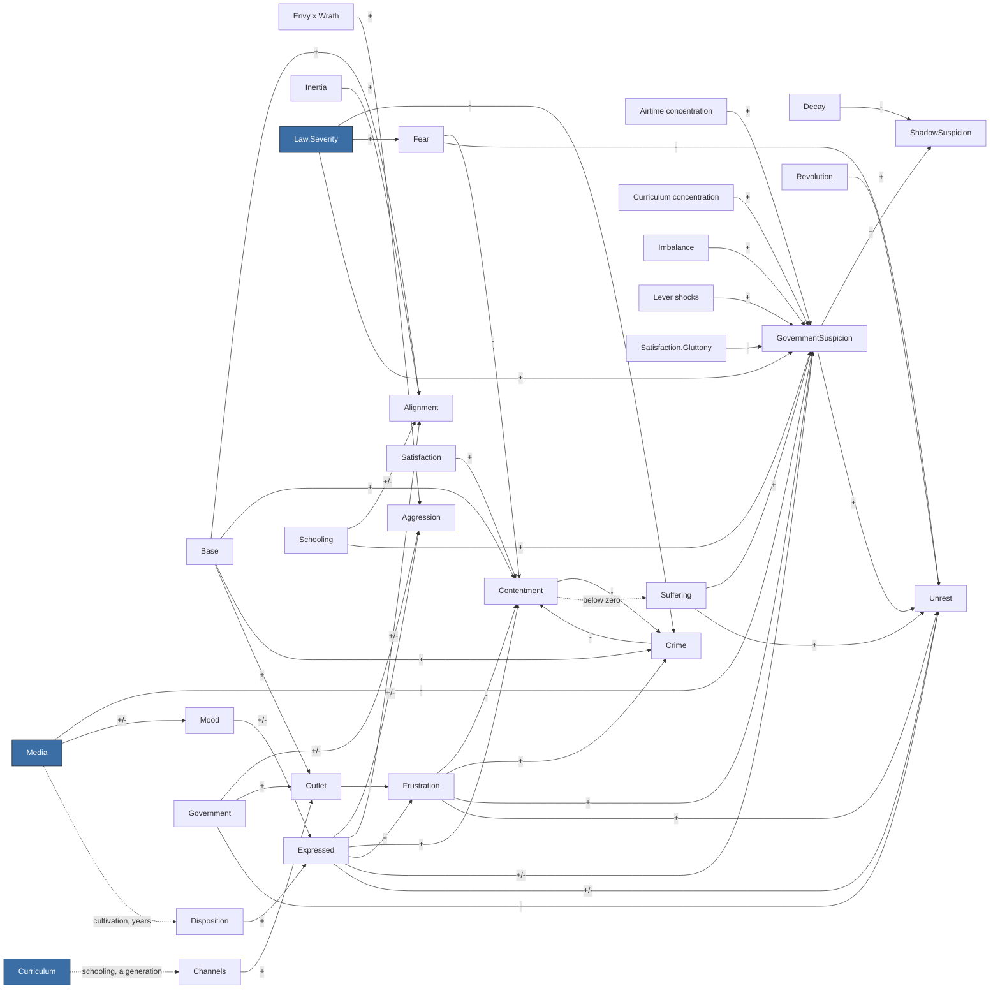

<!-- GENERATED by Tools/Headless/Runner (docs command). Do not edit by hand: change the code, then regenerate. -->
# Society causal graph

What feeds what in the society model, observed from the ledger rather than declared: every term the
simulation recorded while the three-nation scenario ran each built-in lever script for 60 years
(baseline, wrath-media, military-school, iron-fist, velvet-glove, bread-and-circuses, stoke-then-channel, scholars, false-revolution, people-vote, tyranny). Solid arrows are observed terms; dotted arrows are slow stock dynamics
that the ledger does not record (declared in Tools/Headless/Runner/DocsCommand.cs). The model itself is
explained in Docs/simulation/MODEL.md.

## Overview (per-vice quantities merged)

## Every observed term

Rows marked `*` stand for seven rows, one per vice (Media.Wrath -> Mood.Wrath, and so on).
Typical size is the mean absolute contribution per tick across all runs and nations.

| Source | Target | Sign | Typical size |
|---|---|---|---|
| Envy x Wrath | Aggression | + | 0.0608 |
| Expressed.Envy | Aggression | + | 0.0337 |
| Expressed.Gluttony | Aggression | + | 0.0204 |
| Expressed.Greed | Aggression | + | 0.0689 |
| Expressed.Pride | Aggression | + | 0.0565 |
| Expressed.Sloth | Aggression | - | 0.0552 |
| Expressed.Wrath | Aggression | + | 0.1962 |
| Government | Aggression | +/- | 0.0771 |
| Base | Alignment.Communism | + | 0.0500 |
| Expressed.Envy | Alignment.Communism | +/- | 0.0333 |
| Expressed.Greed | Alignment.Communism | +/- | 0.0071 |
| Schooling.Agriculture | Alignment.Communism | +/- | 0.0246 |
| Schooling.Infrastructure | Alignment.Communism | +/- | 0.0162 |
| Base | Alignment.Democracy | + | 0.1000 |
| Expressed.Envy | Alignment.Democracy | +/- | 0.0143 |
| Expressed.Pride | Alignment.Democracy | +/- | 0.0265 |
| Expressed.Wrath | Alignment.Democracy | +/- | 0.0171 |
| Inertia | Alignment.Democracy | + | 0.0500 |
| Schooling.Commerce | Alignment.Democracy | - | 0.0329 |
| Schooling.Infrastructure | Alignment.Democracy | +/- | 0.0162 |
| Schooling.Science | Alignment.Democracy | +/- | 0.0302 |
| Base | Alignment.MilitaryJunta | + | 0.0500 |
| Expressed.Pride | Alignment.MilitaryJunta | +/- | 0.0353 |
| Expressed.Wrath | Alignment.MilitaryJunta | +/- | 0.1028 |
| Inertia | Alignment.MilitaryJunta | + | 0.0500 |
| Schooling.Military | Alignment.MilitaryJunta | +/- | 0.0981 |
| Base | Alignment.Monarchy | + | 0.1000 |
| Expressed.Pride | Alignment.Monarchy | +/- | 0.0353 |
| Expressed.Sloth | Alignment.Monarchy | +/- | 0.0450 |
| Inertia | Alignment.Monarchy | + | 0.0500 |
| Schooling.Agriculture | Alignment.Monarchy | +/- | 0.0246 |
| Schooling.Military | Alignment.Monarchy | +/- | 0.0196 |
| Base | Alignment.Theocracy | + | 0.0500 |
| Expressed.Gluttony | Alignment.Theocracy | +/- | 0.0228 |
| Expressed.Lust | Alignment.Theocracy | +/- | 0.0131 |
| Expressed.Sloth | Alignment.Theocracy | +/- | 0.0563 |
| Schooling.Arts | Alignment.Theocracy | +/- | 0.0136 |
| Schooling.Science | Alignment.Theocracy | +/- | 0.0402 |
| Base | Contentment | + | 0.1500 |
| Crime | Contentment | - | 0.0371 |
| Expressed.Sloth | Contentment | + | 0.0096 |
| Fear | Contentment | - | 0.0760 |
| Frustration.Envy | Contentment | - | 0.0090 |
| Frustration.Gluttony | Contentment | - | 0.0189 |
| Frustration.Greed | Contentment | - | 0.0086 |
| Frustration.Lust | Contentment | - | 0.0080 |
| Frustration.Pride | Contentment | - | 0.0074 |
| Frustration.Sloth | Contentment | - | 0.0148 |
| Frustration.Wrath | Contentment | - | 0.0175 |
| Satisfaction | Contentment | + | 0.1681 |
| Base | Crime | + | 0.1200 |
| Contentment | Crime | - | 0.0260 |
| Frustration.Envy | Crime | + | 0.0157 |
| Frustration.Gluttony | Crime | + | 0.0111 |
| Frustration.Greed | Crime | + | 0.0175 |
| Frustration.Lust | Crime | + | 0.0046 |
| Frustration.Pride | Crime | + | 0.0042 |
| Frustration.Sloth | Crime | + | 0.0044 |
| Frustration.Wrath | Crime | + | 0.0347 |
| Law.Severity | Crime | - | 0.0618 |
| Disposition.* | Expressed.* | + | 0.3768 |
| Mood.* | Expressed.* | +/- | 0.0261 |
| Law.Severity | Fear | + | 0.3089 |
| Expressed.* | Frustration.* | + | 0.4276 |
| Outlet.* | Frustration.* | - | 0.3571 |
| Airtime concentration | GovernmentSuspicion | + | 0.1371 |
| Curriculum concentration | GovernmentSuspicion | + | 0.0463 |
| Expressed.Pride | GovernmentSuspicion | + | 0.0565 |
| Expressed.Sloth | GovernmentSuspicion | - | 0.0552 |
| Frustration.Envy | GovernmentSuspicion | + | 0.0261 |
| Frustration.Greed | GovernmentSuspicion | + | 0.0250 |
| Imbalance | GovernmentSuspicion | + | 0.0365 |
| Law.Severity | GovernmentSuspicion | + | 0.0417 |
| Lever shocks | GovernmentSuspicion | + | 0.0146 |
| Media.Neutral | GovernmentSuspicion | - | 0.0187 |
| Satisfaction.Gluttony | GovernmentSuspicion | - | 0.0689 |
| Schooling.Science | GovernmentSuspicion | + | 0.0408 |
| Suffering | GovernmentSuspicion | + | 0.0164 |
| Media.* | Mood.* | +/- | 0.0221 |
| Channels.* | Outlet.* | + | 0.0977 |
| Base | Outlet.Envy | + | 0.2500 |
| Government | Outlet.Envy | + | 0.0500 |
| Base | Outlet.Gluttony | + | 0.2500 |
| Base | Outlet.Greed | + | 0.2500 |
| Base | Outlet.Lust | + | 0.2500 |
| Base | Outlet.Pride | + | 0.2500 |
| Government | Outlet.Pride | + | 0.0609 |
| Base | Outlet.Sloth | + | 0.2500 |
| Base | Outlet.Wrath | + | 0.2500 |
| Government | Outlet.Wrath | + | 0.1000 |
| Decay | ShadowSuspicion | - | 0.0002 |
| GovernmentSuspicion | ShadowSuspicion | + | 0.0007 |
| Expressed.Envy | Unrest | + | 0.0073 |
| Expressed.Pride | Unrest | + | 0.0073 |
| Expressed.Sloth | Unrest | - | 0.0552 |
| Fear | Unrest | - | 0.0729 |
| Frustration.Wrath | Unrest | + | 0.0307 |
| Government | Unrest | - | 0.0800 |
| GovernmentSuspicion | Unrest | + | 0.0321 |
| Revolution | Unrest | + | 0.5000 |
| Suffering | Unrest | + | 0.0508 |
